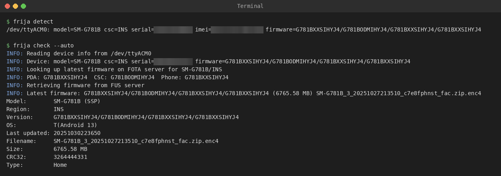
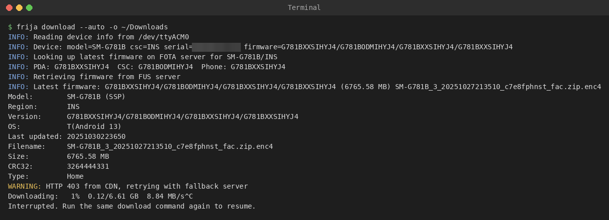

# frija-cli

Command-line port of **Frija v2.0**, the Windows-only Samsung firmware downloader.
It was rebuilt from the decompiled Windows app. It talks to the same Samsung servers
in the same way: FOTA version lookup, then FUS check, download, CRC32 check and decrypt.

Want a window instead? See **[frija-gtk](https://github.com/Shantil-K/frija-gtk)**, a
separate GTK front end that uses this package. It's kept separate so the CLI has no GUI dependencies.

Reading a phone over USB and finding its latest firmware:



Downloading it (Ctrl+C pauses; run the same command again to resume):



## Requirements

- Python 3.10+
- `requests` and `cryptography` (`pip install -r requirements.txt`, or your distro's
  `python3-requests` / `python3-cryptography` packages)
- Works on **Linux and Windows**. macOS should work too, though it is untested.
- The USB "Auto" mode needs `pyserial` on Windows (installed automatically by pip there)
  and on macOS (`pip install "frija-cli[serial]"`). On Linux it needs nothing extra.

## Installing

Run it from this folder without installing:

```sh
./frija.sh --help          # Linux / macOS
frija.cmd --help           # Windows
```

Or install it to get a `frija` command:

```sh
pip install --user git+https://github.com/Shantil-K/frija-cli.git
# or, from a clone:
pip install --user .
```

## Usage

The three modes match the tabs in the Windows app.

**Manual mode**: model, region (CSC) and IMEI or serial number:

```sh
./frija.sh check    -m SM-S928B -r EUX -i <IMEI or serial>
./frija.sh download -m SM-S928B -r EUX -i <IMEI or serial> -o ~/Downloads
```

**Auto mode**: reads model, CSC and serial from a phone plugged in over USB:

```sh
./frija.sh detect            # show what the phone reports
./frija.sh download --auto -o ~/Downloads
```

**Legacy mode**: query from a specific firmware version instead of the FOTA lookup:

```sh
./frija.sh check -m SM-S928B -r EUX --fw S928BXXU1AXA1/S928BOXM1AXA1/S928BXXU1AXA1
```

`download` options:

| Option | Meaning |
|---|---|
| `-o DIR` | output folder (default: current folder) |
| *(re-run the same command)* | resumes a partial download |
| `--overwrite` | start the download from scratch |
| `--no-crc` | skip CRC32 verification (the original's "Check CRC" setting) |
| `--no-decrypt` | keep the `.enc2`/`.enc4` file and don't decrypt it |
| `--keep-encrypted` | decrypt, but don't delete the encrypted file afterwards |
| `--factory` | ask for factory firmware (the original's "Binary Nature" setting) |

To decrypt a file you already downloaded:

```sh
./frija.sh decrypt FILE.zip.enc4 -m SM-S928B -r EUX -i <IMEI>       # fetches the key info again
./frija.sh decrypt FILE.zip.enc2 -m MODEL -r CSC --version PDA/CSC/PHONE/PDA
./frija.sh decrypt FILE.zip.enc4 --version PDA/CSC/PHONE/PDA --logic-value VALUE
```

Add `-v` to any command for debug output. This includes the raw server XML, which is
what the Windows log file contained.

## USB / Auto mode

The phone exposes a modem interface that answers `AT+DEVCONINFO` with its model, CSC,
serial number and firmware version. `--port` picks a port by hand.

**Windows.** Frija looks for the "SAMSUNG Mobile USB Modem" COM port, just like the
original app. It finds it through the registry and skips ports from devices that are
no longer plugged in. The Samsung USB driver must be installed (Smart Switch installs
it). Close Smart Switch if it is holding the port.

**Linux.** The same interface appears as `/dev/ttyACM*` (USB vendor `04e8`). The
kernel's `cdc_acm` driver handles it, so no Samsung driver is needed.

- Your user must be in the `dialout` group to open the port.
- **ModemManager** often grabs this port and blocks the `AT+DEVCONINFO` query. If
  `detect` fails, stop it while you use Frija: `sudo systemctl stop ModemManager`.
- Some phones only expose the modem port while unlocked, or in a particular USB mode.

## What was left out

These are Windows features that aren't needed for downloading: the app's self-updater,
Bugsnag crash reporting, the device picture lookup.

## Layout

| File | Ported from |
|---|---|
| `frija/fus.py` | `Frija.Backend.Firmware.FUS`, `FUSRequest`, `FUSHelper` |
| `frija/fota.py` | `Frija.Backend.Firmware.FotaFirmware` |
| `frija/crypto.py` | `AesDeEncode`, `Utility.CreateLogicCheck`, `FirmwareDecryptor` |
| `frija/modem.py` | `Frija.ModemInterface.ModemController` (Linux: sysfs + termios; Windows: registry + pyserial). Only loaded for USB mode. |
| `frija/core.py` | download / CRC / decrypt workflow from `MainWindow` (a stable API for front ends) |
| `frija/cli.py` | command line, replacing the WPF window and the Auto/Manual/Legacy views |

## Credits

- **[Frija](https://github.com/SlackingVeteran/frija)** by wssyncmldm / SlackingVeteran:
  the original Windows tool. Its features and workflow are what this project ports.
- **[samloader](https://github.com/nlscc/samloader)** (GPL-3.0): an earlier open-source
  implementation of Samsung's firmware server protocol.

## Disclaimer

This project is not affiliated with, endorsed by or connected to Samsung, or to the
original Frija developers. "Samsung" and "Galaxy" are trademarks of Samsung Electronics.

It only downloads firmware that Samsung's own servers provide for the device details
you enter. Samsung can change those servers at any time, and this tool may stop working.
Use it at your own risk and in line with the laws and terms that apply to you. As the
licence says, it comes with no warranty.

## License

GPL-3.0-or-later. See [LICENSE](LICENSE).
